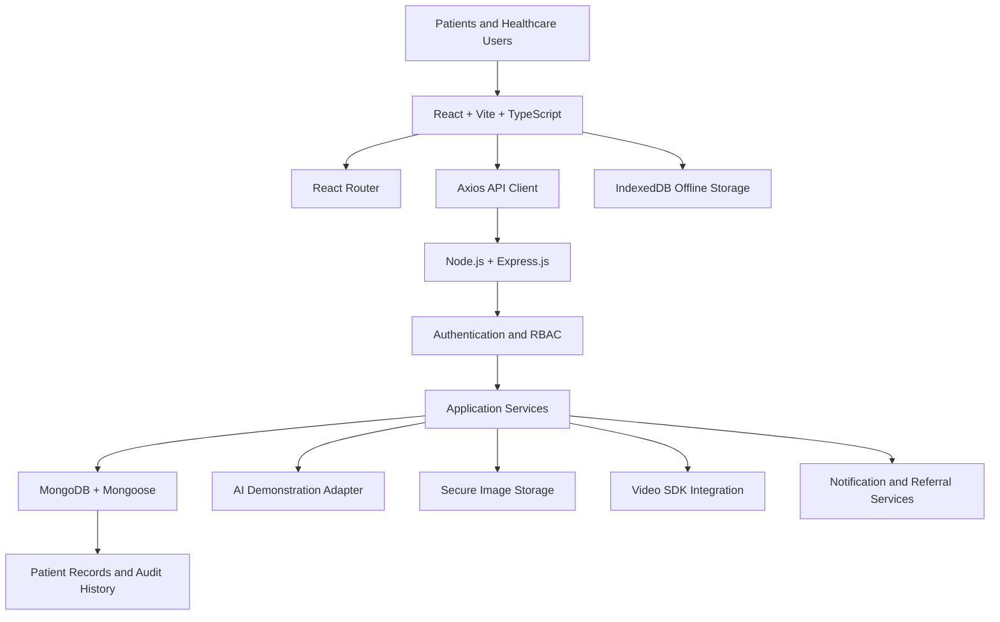

# AAROGYA DRISHTI
### AI-Assisted Oral Cancer Early-Screening and Patient-Care Platform

<p align="center">

**Connecting Community Health Workers, Medical Officers, Specialists, and District Healthcare Administration through a unified digital platform.**

</p>

---

## 1. Project Overview

**AAROGYA DRISHTI** is an AI-assisted oral cancer early-screening and patient-care coordination platform designed to support community-level screening, clinical review, specialist referrals, telemedicine, diagnostic tracking, and patient follow-up.

The platform aims to strengthen the connection between field health workers, Medical Officers, Specialists, patients, and district-level healthcare administration.

It provides a unified digital workflow for patient registration, oral screening, image management, AI-assisted demonstration screening, clinical review, appointments, referrals, diagnostics, and longitudinal patient records.

The project is being developed for the **AAROHAN Inter-Centre Hackathon 2026**, organized by ITDA Paderu, Alluri Sitharama Raju District, Andhra Pradesh.

**Important:** The hackathon version is a demonstration platform. It is not a clinically validated medical diagnostic system and must not be used for real-world clinical decisions.

## 2. Problem Statement

Oral cancer screening and patient follow-up require coordination between community-level healthcare workers, primary healthcare facilities, Medical Officers, Specialists, and diagnostic centres.

Challenges that the proposed platform aims to address include:

- Fragmented patient screening records.
- Difficulty maintaining longitudinal patient histories.
- Delays in clinical review and specialist referrals.
- Limited coordination between healthcare facilities.
- Difficulty tracking appointments and missed visits.
- Limited visibility into pending investigations and follow-up.
- Connectivity challenges in remote and rural areas.
- Language and usability barriers for field healthcare workers.

AAROGYA DRISHTI aims to provide a connected digital workflow that improves visibility, coordination, record management, and follow-up.

## 3. Project Objectives

1. Digitize patient registration and screening records.
2. Support community health workers with guided oral examination workflows.
3. Demonstrate image-quality assessment and AI-assisted screening.
4. Provide Medical Officers with a structured clinical review portal.
5. Connect patients with Specialists through referrals and telemedicine.
6. Track appointments, investigations, and follow-up activities.
7. Maintain a longitudinal patient record with an audit trail.
8. Provide District Officers with aggregate programme indicators.
9. Support Telugu and English interfaces.
10. Enable appropriate offline data capture and synchronization.
11. Provide an application-use assistant named SAMMAKKA.
12. Improve coordination across participating healthcare facilities.

## 4. Key Features and Modules

The following describes the intended application functionality. Implementation status must be verified during development.

### 4.1 Health Worker Mobile-Friendly Application

- Patient registration.
- Unique Patient ID generation.
- Patient history collection.
- Tobacco and exposure history.
- Guided oral examination workflow.
- Image capture and preview.
- Image-quality feedback.
- Screening record creation.
- Offline registration and screening drafts.
- Synchronization when connectivity returns.
- Patient screening history.

### 4.2 AI-Assisted Screening

- Image-quality assessment.
- Modular AI inference interface.
- Demonstration screening output.
- Structured result presentation.
- AI model version and provenance information.
- Advisory result history.
- Clear separation between AI output and clinical decisions.

Possible demonstration states:

- Image insufficient for demonstration assessment.
- Suspicious finding indicated by demonstration model — clinical review required.
- No suspicious finding identified by demonstration model — does not rule out disease.

**AI SAFETY DISCLAIMER: NOT FOR CLINICAL USE.**

Mock or research AI outputs are demonstration-only and must never be presented as a diagnosis.

### 4.3 Medical Officer Portal

- Screening review queue.
- Patient history and permitted image access.
- AI advisory result review.
- Clinical observations.
- Clinical decision recording.
- Agreement, disagreement, and deferment workflows.
- Image recapture requests.
- Specialist referral creation.
- Timestamped clinical notes.

The Medical Officer retains responsibility for clinical decisions.

### 4.4 Specialist Portal

- Specialist referral queue.
- Authorized patient record review.
- Specialist assessment.
- Consultation notes.
- Further examination requests.
- Investigation recommendations.
- Follow-up planning.

### 4.5 Telemedicine

- Specialist consultation requests.
- Appointment scheduling.
- Secure demonstration meeting links.
- Audio and video consultation.
- Consultation documentation.
- Consultation outcomes.
- Follow-up actions.

Video recording is disabled by default in the intended design.

### 4.6 Appointment and Referral Management

- Facility selection.
- Appointment availability.
- Booking and rescheduling.
- Cancellation tracking.
- Referral slips in Telugu and English.
- Attendance tracking.
- Missed appointment tracking.
- Follow-up reminders.
- Navigator assignment.

### 4.7 Diagnostics and Treatment Tracking

- Investigation orders.
- Biopsy tracking.
- Sample collection status.
- Pathology report management.
- Clinician review.
- Follow-up and treatment linkage.

The system distinguishes screening findings, clinical suspicion, clinician-confirmed precancer, and pathology-confirmed malignancy.

### 4.8 Patient Record Management

A unified longitudinal patient timeline is intended to include:

- Registration.
- Consent.
- Screening history.
- Image records.
- AI demonstration history.
- Clinical reviews.
- Specialist consultations.
- Referrals.
- Appointments.
- Investigations and reports.
- Clinician-entered conclusions.
- Follow-up activities.

Important record changes must retain appropriate user, timestamp, and audit information.

### 4.9 District and ITDA Project Officer Dashboards

These dashboards are intended to provide role-scoped, aggregate programme indicators such as:

- Registered patients.
- Completed screenings.
- Medical Officer reviews.
- Suspicious findings requiring clinical review.
- Specialist referrals.
- Completed and overdue appointments.
- Biopsies advised and completed.
- Pathology reports pending and received.
- Clinician-confirmed precancers and cancers.
- Treatment linkage.
- Loss to follow-up.
- Average time to review and diagnosis.

Filters are planned for village, mandal, and PHC.

Aggregate reporting is the default. Identifiable patient information requires explicit authorization and auditing.

**Implementation status:** Dashboard APIs are not yet implemented. District Officer and ITDA Project Officer accounts are denied access to identifiable patient records.

### 4.10 SAMMAKKA — Application Assistant

**SAMMAKKA** is the friendly 3D tribal-girl application assistant.

Planned capabilities:

- Floating assistant button on every application page.
- Interactive chat panel.
- Telugu and English support.
- Registration guidance.
- Screening and photo-capture guidance.
- Appointment and referral guidance.
- Patient-record navigation assistance.
- Application troubleshooting.
- Simple explanations for low-literacy users.

SAMMAKKA is an application-use assistant, not a medical professional. Medical questions must be directed to qualified healthcare professionals.

### 4.11 User Profiles

Individual profile photos or avatars are planned for:

1. Patient.
2. ASHA Worker / Health Worker.
3. Medical Officer.
4. Specialist.
5. District Officer.
6. ITDA Project Officer.
7. Administrator.

Profile visibility and patient information access must follow role-based permissions and consent requirements.

## 5. Technology Stack

The project follows the **MERN architecture**, with TypeScript used for frontend development.

| Layer | Technology |
|---|---|
| Frontend | React |
| Frontend Build Tool | Vite |
| Programming Language | TypeScript |
| Routing | React Router |
| API Communication | Axios |
| Backend Runtime | Node.js |
| Backend Framework | Express.js |
| Database | MongoDB Community Edition |
| Database ODM | Mongoose |
| Offline Storage | IndexedDB |
| Version Control | Git |
| Code Repository | GitHub |
| Frontend Testing | Vitest and React Testing Library |
| Backend Testing | Node.js-compatible testing tools |
| API Testing | Postman or equivalent |
| AI Integration | JavaScript / TypeScript-compatible adapter |
| Video Consultation | Suitable video SDK/provider |
| Image Storage | Secure image/document storage |

**Technology decision:** MongoDB Community Edition and Mongoose are the selected database technologies. PostgreSQL and Python backend services are not part of this project's chosen stack.

## 6. System Architecture

The application follows a frontend-backend-database architecture.



### Main Architecture Components

**Frontend**
- User interface.
- Role-based dashboards.
- Patient registration.
- Screening workflows.
- Image previews.
- Telugu and English language switching.
- SAMMAKKA assistant.
- Offline user workflows.

**Backend**
- REST API endpoints.
- Authentication.
- Role-based authorization.
- Patient management.
- Screening management.
- Clinical review.
- Appointments and referrals.
- Diagnostics tracking.
- Audit logging.
- AI adapter integration.

**Database**
- User records.
- Patient records.
- Screening records.
- Clinical reviews.
- Appointments.
- Referrals.
- Diagnostic records.
- Facility information.
- Notifications.
- Audit logs.
- Offline synchronization metadata.

## 7. User Roles

| Role | Main Responsibilities |
|---|---|
| Patient | View permitted personal information and appointments |
| Health Worker | Register patients and conduct screening workflows |
| Medical Officer | Review screenings and record clinical decisions |
| Specialist | Review referrals and specialist assessments |
| District Officer | Monitor aggregate programme indicators |
| ITDA Project Officer | Monitor authorized aggregate programme implementation indicators |
| Administrator | Manage authorized system users and configuration |

Every role must have appropriate permissions enforced by the backend.

## 8. Language Support

The platform prioritizes:

- **Telugu** — mandatory interface support.
- **English** — mandatory interface support.

Essential workflows must be understandable and usable in both languages.

Language switching should be simple and accessible.

Hindi may be considered as a future enhancement.

## 9. Offline Functionality

Offline functionality is important for health workers operating in locations with unreliable internet connectivity.

Planned capabilities:

- Offline registration drafts.
- Offline screening drafts.
- Local storage of permitted records.
- Synchronization when connectivity returns.
- Retry handling.
- Duplicate prevention.
- Synchronization status visibility.
- Conflict handling.

IndexedDB will be used for suitable offline data storage, with additional protection for sensitive data.

**Security note:** IndexedDB alone does not encrypt patient information.

## 10. Security and Privacy

Security and privacy are essential project requirements.

Planned controls include:

- Individual user accounts.
- Role-based access control.
- Least-privilege permissions.
- Strong authentication and session management.
- Additional authentication for privileged accounts.
- HTTPS/TLS for deployed environments.
- Secure password hashing.
- Environment-based secret management.
- Protected image and document access.
- Sensitive offline-data protection.
- Audit logs for important actions.
- Backup and recovery procedures.
- Restricted bulk export.
- Consent management.
- Appropriate retention policies.
- Privacy-by-design considerations.

The project will consider applicable Indian data protection requirements, including the Digital Personal Data Protection framework.

A hackathon demonstration does not constitute a production security certification.

## 11. Medical and AI Safety

AAROGYA DRISHTI is intended to support healthcare workflows, not replace qualified healthcare professionals.

The hackathon version uses synthetic patient records and demonstration data.

All mock or research AI output must carry the following warning:

> NOT FOR CLINICAL USE. Demonstration or research output only. This result is not a diagnosis and must not be used to make treatment decisions.

The system must not:

- Diagnose cancer automatically.
- Assign cancer stages from photographs.
- Guarantee that a patient is cancer-free.
- Replace clinical examination.
- Replace biopsy or pathology when clinically indicated.
- Recommend treatment based only on AI output.

Clinical decisions remain the responsibility of qualified healthcare professionals.

## 12. Project Folder Structure

The intended repository structure will evolve as implementation progresses.

```text
AAROGYA-DRISHTI-MERN/
│
├── docs/
│   ├── PROJECT_REQUIREMENTS.md
│   ├── PROJECT_ARCHITECTURE.md
│   ├── DEVELOPMENT_ROADMAP.md
│   ├── DATABASE_DESIGN.md
│   ├── SECURITY_AND_PRIVACY.md
│   ├── API_DOCUMENTATION.md
│   └── TESTING_AND_DEMO.md
│
├── client/
│   ├── public/
│   ├── src/
│   │   ├── assets/
│   │   ├── components/
│   │   ├── pages/
│   │   ├── layouts/
│   │   ├── routes/
│   │   ├── services/
│   │   ├── hooks/
│   │   ├── contexts/
│   │   ├── translations/
│   │   ├── types/
│   │   └── utils/
│   └── package.json
│
├── server/
│   ├── src/
│   │   ├── config/
│   │   ├── controllers/
│   │   ├── middleware/
│   │   ├── models/
│   │   ├── routes/
│   │   ├── services/
│   │   ├── validators/
│   │   ├── utils/
│   │   └── app.ts
│   └── package.json
│
├── tests/
│
├── .gitignore
├── README.md
└── package.json
```

This is the planned structure, not a claim that all directories and files already exist.

## 13. Development Environment Requirements

Install the following software before development:

1. Node.js and npm.
2. MongoDB Community Edition.
3. MongoDB Compass.
4. Visual Studio Code.
5. Git.
6. Postman or an equivalent API testing tool.
7. A modern web browser.

Recommended versions should be checked against the project's dependency compatibility before installation or upgrades.

## 14. Installation and Setup

The following instructions describe the intended development setup. They will become fully executable after the frontend and backend packages are created and their dependencies are configured.

### Step 1 — Clone the repository

```bash
git clone <YOUR-GITHUB-REPOSITORY-URL>
```

```bash
cd AAROGYA-DRISHTI-MERN
```

### Step 2 — Install root dependencies

```bash
npm install
```

Run this only after the root `package.json` and its dependencies have been configured.

### Step 3 — Install frontend dependencies

```bash
cd client
npm install
```

### Step 4 — Install backend dependencies

```bash
cd ../server
npm install
```

### Step 5 — Configure environment variables

Create environment files based on the eventual environment templates.

Typical backend configuration will include:

```env
PORT=5000
NODE_ENV=development
MONGODB_URI=mongodb://127.0.0.1:27017/aarogya_drishti
```

Authentication secrets and other credentials must be generated securely and must never be committed to Git.

The example above is a configuration illustration, not a production-ready secret configuration.

### Step 6 — Start MongoDB

Ensure that the MongoDB Community Edition service is running.

### Step 7 — Start the backend

Use the development script configured in the backend `package.json`.

### Step 8 — Start the frontend

Use the development script configured in the frontend `package.json`.

Exact scripts and ports will be documented after implementation.

## 15. Testing Strategy

Testing will cover:

- Unit testing.
- Integration testing.
- End-to-end testing.
- API testing.
- Authentication and authorization testing.
- Image upload testing.
- AI demonstration testing.
- Offline synchronization testing.
- Telugu and English testing.
- Responsive UI testing.
- Security and privacy testing.
- Performance and reliability testing.

Important hackathon evaluation scenarios include:

1. Telugu patient registration.
2. Offline registration and synchronization.
3. Poor image-quality handling.
4. Medical Officer override of AI advisory output.
5. Unauthorized access rejection.
6. Missed appointment tracking.
7. Network failure and recovery.
8. Patient timeline and district dashboard verification.

See [TESTING_AND_DEMO.md](docs/TESTING_AND_DEMO.md) for the complete testing plan.

## 16. Hackathon Demonstration Scenario

The compulsory demonstration will use a fictional patient:

| Field | Synthetic Demonstration Data |
|---|---|
| Age | 46 years |
| Location | G. Madugula |
| History | Fictional tobacco-chewing history |
| Finding | Fictional persistent white cheek patch |
| Data Type | Synthetic |

The demonstration will cover:

1. Telugu patient registration.
2. Unique Patient ID generation.
3. Oral screening and image capture.
4. Image-quality assessment.
5. Clearly labelled AI demonstration output.
6. Medical Officer review.
7. Specialist referral.
8. Secure demonstration video consultation.
9. Simulated biopsy and pathology workflow.
10. Authorized clinician-entered simulated result.
11. Patient longitudinal timeline.
12. Navigator follow-up.
13. District Officer dashboard.
14. Role-based security demonstration.
15. SAMMAKKA assistant.

No actual patient information or clinical images will be used.

## 17. Development Roadmap

The application will be developed in stages.

| Phase | Development Area |
|---|---|
| Phase 1 | Project setup and MERN foundation |
| Phase 2 | Authentication and role-based access |
| Phase 3 | Patient registration and profile management |
| Phase 4 | Screening and image management |
| Phase 5 | AI demonstration adapter |
| Phase 6 | Medical Officer and Specialist portals |
| Phase 7 | Appointments and referrals |
| Phase 8 | Telemedicine integration |
| Phase 9 | Diagnostics and longitudinal records |
| Phase 10 | District dashboard |
| Phase 11 | Offline support and synchronization |
| Phase 12 | SAMMAKKA assistant and multilingual improvements |
| Phase 13 | Testing, security review, and hackathon deployment |

Implementation will proceed incrementally, with verification after each major stage.

See [DEVELOPMENT_ROADMAP.md](docs/DEVELOPMENT_ROADMAP.md).

## 18. Project Documentation

Detailed project documentation is available in the `docs/` directory.

| Document | Purpose |
|---|---|
| [PROJECT_REQUIREMENTS.md](docs/PROJECT_REQUIREMENTS.md) | Official and additional project requirements |
| [PROJECT_ARCHITECTURE.md](docs/PROJECT_ARCHITECTURE.md) | System architecture and data flow |
| [DEVELOPMENT_ROADMAP.md](docs/DEVELOPMENT_ROADMAP.md) | Development phases and milestones |
| [DATABASE_DESIGN.md](docs/DATABASE_DESIGN.md) | MongoDB collections and relationships |
| [SECURITY_AND_PRIVACY.md](docs/SECURITY_AND_PRIVACY.md) | Security, privacy, and access control |
| [API_DOCUMENTATION.md](docs/API_DOCUMENTATION.md) | Planned REST API endpoints and structures |
| [TESTING_AND_DEMO.md](docs/TESTING_AND_DEMO.md) | Testing strategy and hackathon demonstration |

## 19. Current Project Status

**Project status: Documentation completed; application implementation pending verification and development.**

The project documentation has been prepared.

The next development stage is to establish the working MERN foundation.

Implementation status must be updated as features are actually built and tested.

| Component | Status |
|---|---|
| Project requirements documentation | Prepared |
| System architecture documentation | Prepared |
| Development roadmap | Prepared |
| Database design | Prepared |
| Security and privacy plan | Prepared |
| API documentation | Prepared |
| Testing and demo plan | Prepared |
| Main README | Prepared |
| Frontend implementation | Pending |
| Backend implementation | Pending |
| Database models | Pending |
| Authentication | Pending |
| Application modules | Pending |
| AI demonstration integration | Pending |
| Offline functionality | Pending |
| Video integration | Pending |
| Testing and deployment | Pending |

## 20. Responsible Use and Future Clinical Deployment

The hackathon version is intended for software demonstration and evaluation using synthetic data.

Any future real-world deployment will require appropriate:

- Institutional authorization.
- Clinical governance.
- Qualified healthcare professional involvement.
- Privacy and security assessments.
- Applicable ethics and regulatory approvals.
- Approved clinical protocols.
- Secure operational infrastructure.
- Independent testing and validation.

The platform must not be used to make real patient diagnosis or treatment decisions during the hackathon.

## 21. Project Vision

AAROGYA DRISHTI aims to support a connected, accessible, and coordinated oral healthcare workflow.

By bringing together field health workers, Medical Officers, Specialists, and district-level administration, the project seeks to improve the organization of screening records, referrals, diagnostic follow-up, and patient-care coordination.

**Our vision: Better coordination. Earlier clinical attention. More connected patient care.**

---

**Project Name:** AAROGYA DRISHTI  
**Hackathon:** AAROHAN Inter-Centre Hackathon 2026  
**Organizing Institution:** ITDA Paderu, Alluri Sitharama Raju District, Andhra Pradesh  
**Technology:** MERN Stack with TypeScript  
**Repository:** AAROGYA-DRISHTI-MERN

**Disclaimer:** This project is a hackathon demonstration platform and is NOT FOR CLINICAL USE.