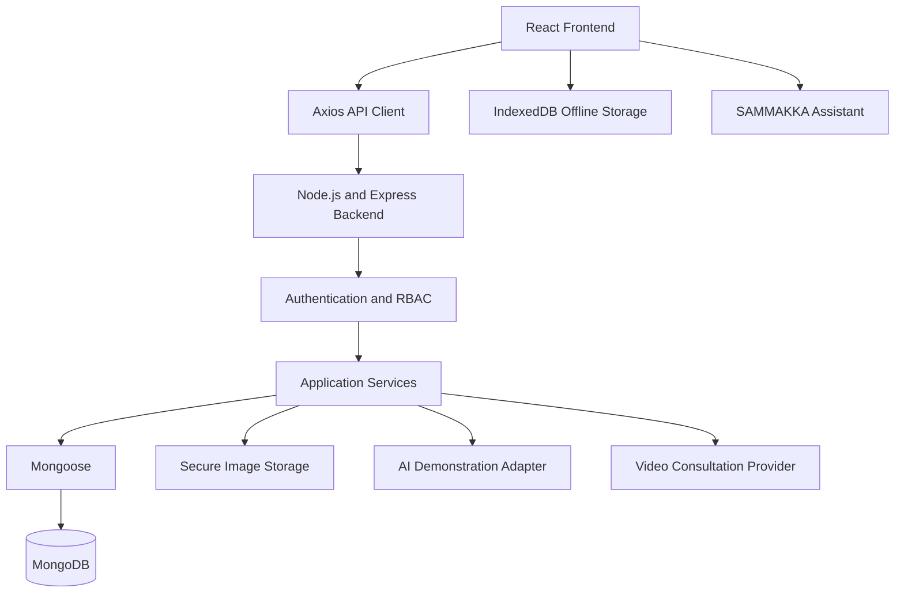

# AAROGYA DRISHTI – Project Architecture

**Version:** 1.0  
**Status:** Planning  
**Technology:** MERN Stack

## 1. Project Overview

AAROGYA DRISHTI is an AI-assisted oral cancer early-screening and patient-care management platform.

It connects patients, ASHA workers, Medical Officers, specialists, diagnostic facilities and district administrators.

The platform supports patient registration, oral screening documentation, clinical review, specialist referrals, diagnostics, follow-up and district-level programme monitoring.

**Hackathon safety:** All demonstrations will use synthetic patient records and permitted educational images. The demonstration AI is NOT FOR CLINICAL USE.

## 2. Technology Stack

### Frontend
- React
- Vite
- TypeScript
- React Router
- Axios
- HTML and CSS

### Backend
- Node.js
- Express.js
- JavaScript / TypeScript

### Database
- MongoDB Community Edition
- Mongoose

### Supporting Technologies
- IndexedDB for offline functionality
- Secure image storage
- JavaScript / TypeScript-compatible AI integration
- Video consultation SDK
- React-compatible charts
- Git and GitHub

**Stack decision:** MERN is our fixed application stack. Python and PostgreSQL will not be introduced as application services or the primary database.

## 3. High-Level Architecture



## 4. User Roles

1. Patient
2. ASHA Worker
3. Medical Officer
4. Specialist
5. District Officer
6. Administrator

Each user will have an individual account and role-specific permissions. Access to patient information will be restricted according to authorization and assigned responsibilities.

## 5. Main Application Modules

1. Authentication and user profiles
2. Patient registration and consent
3. Oral screening and image capture
4. Image quality assessment
5. AI-assisted demonstration screening
6. Medical Officer review
7. Specialist consultation
8. Telemedicine
9. Appointment and referral management
10. Diagnostics and pathology tracking
11. Longitudinal patient records
12. Patient navigation and follow-up
13. District Officer dashboard
14. SAMMAKKA virtual assistant
15. Notifications and audit logs

## 6. Patient Workflow

1. ASHA worker registers a patient.
2. Consent and relevant history are recorded.
3. Oral screening information and permitted images are captured.
4. Image quality is checked.
5. The demonstration AI adapter may return a clearly labelled advisory result.
6. Medical Officer reviews the case and records a clinical decision.
7. Specialist consultation or physical referral is arranged when required.
8. Clinician-directed investigations are tracked.
9. Authorized clinicians record diagnostic outcomes.
10. Follow-up and treatment linkage are monitored.
11. Aggregate programme statistics are displayed on the District Officer dashboard.

## 7. AI Safety

The AI integration will use a modular JavaScript/TypeScript-compatible adapter.

Possible demonstration outputs:
- Image quality insufficient.
- Suspicious finding requiring clinical review.
- No suspicious finding identified by the demonstration model.

These are not medical diagnoses.

AI results must remain separate from signed clinical decisions. Model provenance, version, timestamp and limitations must be recorded.

No mock or research model may be represented as clinically validated.

## 8. SAMMAKKA Assistant

SAMMAKKA is our friendly 3D tribal-girl virtual assistant.

Planned features:
- Floating assistant button throughout the application.
- Telugu and English support.
- Application navigation guidance.
- Patient registration instructions.
- Screening and photo capture guidance.
- Appointment and referral guidance.
- Frequently asked questions and troubleshooting.

SAMMAKKA will not diagnose diseases or recommend medical treatment.

## 9. Offline Architecture

IndexedDB will support temporary offline data capture.

Planned synchronization process:
1. Capture permitted demonstration data offline.
2. Store pending records locally.
3. Identify pending synchronization items.
4. Reconnect to the backend.
5. Validate and synchronize records.
6. Handle conflicts and failures safely.
7. Record synchronization status.

Offline data protection and secure synchronization must be implemented. IndexedDB alone does not provide encryption.

## 10. Security and Privacy

The application will implement:
- Individual accounts.
- Role-based access control.
- Least-privilege permissions.
- Secure authentication and sessions.
- HTTPS/TLS for deployment.
- Protected image and document storage.
- Consent management.
- Audit logs.
- Input validation.
- Backup and recovery planning.
- Privacy-aware reporting.
- Indian data-protection compliance planning.

District-level reporting will show aggregate statistics by default. Access to identifiable patient records requires explicit authorization and auditing.

## 11. User Interface Design

The design will be original and inspired by modern immersive digital experiences.

Planned design:
- Deep navy and charcoal backgrounds.
- Gradient accents and subtle glow effects.
- Smooth transitions and animations.
- Interactive dashboard cards.
- Responsive navigation.
- Animated statistics and charts.
- SAMMAKKA assistant.
- Telugu and English language switching.

We will not copy proprietary website designs.

## 12. Planned Folder Structure

```text
AAROGYA-DRISHTI-MERN/
│
├── client/
│   └── React frontend
│
├── server/
│   └── Express backend
│
├── docs/
│   ├── PROJECT_ARCHITECTURE.md
│   ├── PROJECT_REQUIREMENTS.md
│   ├── DEVELOPMENT_ROADMAP.md
│   ├── DATABASE_DESIGN.md
│   ├── SECURITY_AND_PRIVACY.md
│   ├── API_DOCUMENTATION.md
│   └── TESTING_AND_DEMO.md
│
├── assets/
│   └── Application design assets
│
├── README.md
└── .gitignore
```

## 13. Implementation Principle

This document describes the planned architecture, not completed functionality.

Each feature will be implemented, tested and documented incrementally. A feature will only be marked complete after successful implementation and verification.

**Document status:** Initial architecture plan – Version 1.0.